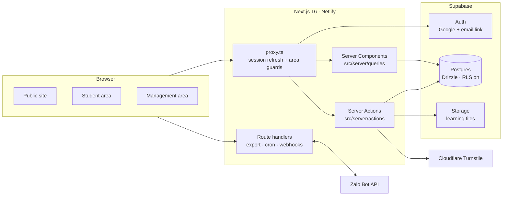
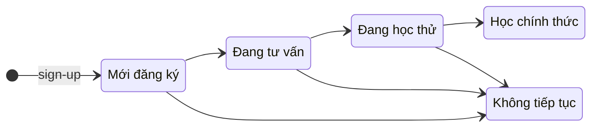

<div align="center">

# RVPY Web

**The course site, student portal and sales CRM for RVPY (Ocean Studio)'s Revit BIM training.**

It replaces a Google Sheets + Zalo workflow that was run entirely by hand.


[](https://rvpy-web.netlify.app/)

**🔗 Live demo: [rvpy-web.netlify.app](https://rvpy-web.netlify.app/)**

[Quick start](#-quick-start) · [Architecture](#-architecture) · [Scripts](#-scripts) · [Testing](#-testing) · [Deploy](#-deployment) · [Docs](#-documentation)

</div>

---

## ✨ What it does

RVPY teaches Revit to working architects and engineers and ships a Revit add-in suite (Auto Join and others) to its students. Before this site, staff copied student IDs, duplicated a tracking sheet per student, shared file permissions, pasted scripted Zalo messages and granted licenses by email, all by hand.

The app has three areas:

| Area | Route | Who | Highlights |
|---|---|---|---|
| 🌐 **Public site** | `/` | Anyone | Course landing page with a scroll-driven 3D building (Three.js), course journey, 9-day trial, fee tiers and referral offer, FAQ, trial sign-up form with Turnstile CAPTCHA, Zalo community links |
| 🎓 **Student area** | `/hoc-vien` | `student` | Lessons, view-only materials, software download and install guide, learning progress, referral link and progress, support/feedback |
| 🛠️ **Management area** | `/quan-tri` | `admin`, `sale` | Lead/student CRM (table + kanban), student profiles, curriculum and learning content, message templates, ad sources, data import, audit log, roles, Zalo bot, Excel export |

### Things the client cares about, and how the app handles them

- **Fear of losing data:** every management list exports to Excel (`/api/export/students`).
- **Fear of leaking data:** documents are view-only and each role sees only what it needs. Sales see only leads from their own ad source.
- **Managing from a phone:** the management area is built and checked at 375px.
- **Sales calls stay human:** the CRM gives scripted templates with a copy button and an explicit "sent" note. It does not message students automatically.

## 🧱 Architecture

One Next.js app serves both the frontend and the backend. There is no separate API server.



**Key decisions**

- **Authorization lives on the server.** Every query and action checks the caller's role and source ownership ([BACKEND_RULES.md §4](BACKEND_RULES.md)). Business tables have RLS enabled with no anon/authenticated policies, so the Supabase Data API exposes nothing.
- **Roles never come from user-editable metadata.** Signing in grants only the public `user` role. Staff and student roles are preapproved in the database.
- **Mock mode:** `NEXT_PUBLIC_USE_MOCK=true` serves `src/mocks` through `src/lib/api`, so UI work needs no database. It is ignored in production.
- **Student IDs** look like `A2610007` (source + `YYMM` + sequence). They are allocated atomically per source and month in `Asia/Ho_Chi_Minh` and never reused, even after a permanent delete.

## 🚀 Quick start

**Requirements:** Node.js 20+, pnpm 10 (`corepack enable`).

### 1. UI only, no database (fastest)

```bash
pnpm install
cp .env.example .env.local
pnpm dev
```

`.env.example` already sets `NEXT_PUBLIC_USE_MOCK=true`. Open http://localhost:3000/dang-nhap and choose a fake identity: **Quản trị**, **Sale**, **Học viên (học thử)** or **Học viên (chính thức)**.

> Mock mode is read-only. Reading, filtering, copying and export work, but saves, uploads and real sign-in do not.

### 2. Full stack with Supabase

1. Create a Supabase project (staging first; see [docs/staging-setup.md](docs/staging-setup.md)).
2. Fill in `.env.local` (see [Environment](#-environment)) and set `NEXT_PUBLIC_USE_MOCK=false`.
3. Apply the schema and seed the reference data (source `R`, curriculum, templates):

   ```bash
   pnpm db:migrate
   pnpm db:seed
   ```

4. Set up the Google provider and passwordless email links: [docs/google-login-and-admin-setup.md](docs/google-login-and-admin-setup.md).
5. Preapprove the first staff accounts from a local, git-ignored file:

   ```bash
   pnpm db:staff data/bootstrap-staff.json
   ```

6. Start the app with `pnpm dev` and sign in.

> `db:migrate`, `db:seed` and `db:staff` write to whatever database `.env.local` points at. Check the target before you run them.

### Running mock and full mode side by side

```powershell
# Terminal 1: full server on :3000
$env:NEXT_PUBLIC_USE_MOCK = 'false'; pnpm dev --port 3000

# Terminal 2: mock server on :3100, separate build output
$env:NEXT_PUBLIC_USE_MOCK = 'true'; $env:RVPY_TEST_DIST_DIR = '.next-crm-check'; pnpm dev --port 3100
```

## 🔐 Environment

Copy `.env.example` to `.env.local`. Never commit `.env.local`. Empty optional variables count as unset.

| Variable | Scope | Purpose |
|---|---|---|
| `NEXT_PUBLIC_USE_MOCK` | public | `true` = mock data, no DB or auth |
| `NEXT_PUBLIC_SITE_URL` | public | Canonical origin for metadata, OG image and sitemap |
| `NEXT_PUBLIC_SUPABASE_URL` / `NEXT_PUBLIC_SUPABASE_PUBLISHABLE_KEY` | public | Supabase client (publishable key only) |
| `SUPABASE_SECRET_KEY` | server | Storage admin tasks (signed URLs, backups) |
| `DATABASE_URL` | server | Transaction pooler, port 6543 (used by the app) |
| `DATABASE_URL_DIRECT` | server | Session pooler/direct, port 5432 (used by migrations) |
| `CRON_SECRET` | server | Bearer token the cron job sends to the Zalo outbox worker |
| `SIGNUP_RATE_LIMIT_SECRET` | server | Hashes rate-limit keys (≥ 32 chars) |
| `NEXT_PUBLIC_TURNSTILE_SITE_KEY` / `TURNSTILE_SECRET_KEY` | mixed | Signup CAPTCHA (required in production) |
| `ZALO_BOT_*` | server | Zalo Bot token, webhook secret and message images |
| `NEXT_PUBLIC_ZALO_CONSULT_PHONE` / `NEXT_PUBLIC_ZALO_BOT_URL` | public | Floating Zalo button and bot link |

Hosted database URLs need `?sslmode=require`. See `.env.example` for the full annotated list.

## 📜 Scripts

| Command | What it does |
|---|---|
| `pnpm dev` | Start the dev server (pages + server actions) |
| `pnpm build` / `pnpm start` | Production build / serve it |
| `pnpm typecheck` | `next typegen` + `tsc --noEmit` |
| `pnpm lint` | ESLint |
| `pnpm test` | Node test runner over `tests/*.test.ts` |
| `pnpm db:generate` | Generate a Drizzle migration from schema changes |
| `pnpm db:migrate` | Apply committed migrations |
| `pnpm db:seed` | Seed reference source, curriculum and templates |
| `pnpm db:studio` | Open Drizzle Studio |
| `pnpm db:staff <file>` | Preapprove staff accounts and owned ad sources |
| `pnpm db:import <xlsx> [--commit] [--update]` | Import a Google Sheets export (report-only without `--commit`) |
| `pnpm zalo:check` / `pnpm zalo:test` | Check the Zalo Bot connection / send a test message |
| `pnpm zalo:webhook:set` | Register the Zalo webhook URL |
| `pnpm zalo:cron:setup` | Schedule outbox retries with Supabase Cron |

Run `pnpm typecheck && pnpm lint` before every commit.

## 🗂️ Project structure

```
src/
├── app/
│   ├── (public)/          landing, /dang-ky sign-up, /tai-khoan
│   ├── (student)/hoc-vien lessons, materials, software, progress, referral, support
│   ├── (admin)/quan-tri   CRM, curriculum, materials, templates, sources, import, audit log, roles, Zalo
│   ├── api/               export/students · cron/zalo-outbox · webhooks/zalo-bot · student/resources
│   ├── auth/ dang-nhap/   sign-in + OAuth/email-link callback
│   └── ui-kit/            dev-only design system showcase
├── components/            ui (shadcn) · landing · admin · student · layout · auth
├── lib/                   shared helpers, zod schemas, api facade (real ↔ mock)
├── mocks/                 fake data for mock mode (fake names only)
├── server/
│   ├── actions/           server actions (mutations)
│   ├── queries/           read models
│   ├── auth/              session + role guards
│   ├── db/                Drizzle schema, migrations (0000–0008), seed
│   └── zalo/              Zalo Bot client + outbox
└── proxy.ts               Next.js 16 proxy: session refresh and area routing
scripts/                   bootstrap, import, Zalo and dev fixtures
tests/                     unit + DB tests (PGlite) and opt-in integration runners
docs/                      design notes, setup guides, verification reports
```

## 👥 Roles and the student pipeline

| Role | Sees |
|---|---|
| `admin` | Everything in management, plus the student area |
| `sale` | Only leads from their own ad source, message templates, their own report |
| `student` | Only the student area and their own data |
| `user` | Public site only (granted automatically on first sign-in) |



Status changes can also go backwards and are recorded in history and the audit log. Payment and license states are tracked separately from the pipeline. The full CRM rules are in [docs/crm-phase-1.md](docs/crm-phase-1.md).

## 🧪 Testing

```bash
pnpm test        # unit + database tests
pnpm typecheck
pnpm lint
```

- Database tests run every committed migration against an in-memory **PGlite** Postgres, so they need no external database.
- `tests/*.mjs` and `tests/ad-source-locks-postgres.ts` are **opt-in integration runners**: real Postgres concurrency, signup E2E and browser checks. The local-Postgres runner creates its own throwaway cluster (`RVPY_POSTGRES_BIN`, default PostgreSQL 16).
- The manual admin checklist is in [docs/admin-e2e-checklist.md](docs/admin-e2e-checklist.md). Check every UI change at 375 / 768 / 1280px in light and dark mode.

## ☁️ Deployment

The app is deployed on **Netlify** at **https://rvpy-web.netlify.app/**.

- Netlify builds it with `pnpm run build` and the `@netlify/plugin-nextjs` runtime. Pages, server actions and route handlers all run as Netlify functions.
- The build settings live in the Netlify site dashboard. The repo has no `netlify.toml`.
- Set the environment variables below under **Site configuration → Environment variables**, then redeploy.
- Zalo outbox retries run through **Supabase Cron**, which calls `/api/cron/zalo-outbox` with `CRON_SECRET` (`pnpm zalo:cron:setup`, see [docs/zalo-bot.md](docs/zalo-bot.md)). The cron entry in [`vercel.json`](vercel.json) only runs on Vercel, so Netlify ignores it.

Production checklist:

- [ ] `NEXT_PUBLIC_USE_MOCK=false` (mock is ignored in production anyway)
- [ ] Supabase URLs and keys, both DB URLs with `sslmode=require`
- [ ] Google provider + Site URL + exact `/auth/callback` redirect URLs
- [ ] `CRON_SECRET`, `SIGNUP_RATE_LIMIT_SECRET`, Turnstile keys restricted to the production hostname
- [ ] `pnpm db:migrate` against production, then `pnpm db:seed` once
- [ ] Staff preapproved with `pnpm db:staff`
- [ ] `NEXT_PUBLIC_SITE_URL` set to the public origin, Zalo webhook registered (`pnpm zalo:webhook:set`) and Supabase Cron installed (`pnpm zalo:cron:setup --apply`)

## 📚 Documentation

| Doc | Contents |
|---|---|
| [CLAUDE.md](CLAUDE.md) | **Source of truth:** product, roles, page map, business rules, build status, open questions |
| [FRONTEND_RULES.md](FRONTEND_RULES.md) | Design tokens, layout patterns, components, quality bar. Live reference at `/ui-kit` |
| [BACKEND_RULES.md](BACKEND_RULES.md) | Supabase + Drizzle, auth, **authorization (§4)**, actions, exports |
| [docs/backend-database-design.md](docs/backend-database-design.md) · [docs/database-erd.md](docs/database-erd.md) | Schema design and ERD |
| [docs/staging-setup.md](docs/staging-setup.md) | Staging project, Google provider, first staff, verification gates |
| [docs/google-login-and-admin-setup.md](docs/google-login-and-admin-setup.md) | Step-by-step Google sign-in + first admin (Vietnamese) |
| [docs/crm-phase-1.md](docs/crm-phase-1.md) | CRM rules: pipeline, filters, duplicates, archive, transfer |
| [docs/signup-protection.md](docs/signup-protection.md) | Signup ownership, CAPTCHA, rate limits, concurrent edits |
| [docs/student-area.md](docs/student-area.md) · [docs/student-onboarding.md](docs/student-onboarding.md) | Student area assumptions and trial onboarding |
| [docs/student-permanent-delete.md](docs/student-permanent-delete.md) | Permanent delete rules and burned codes |
| [docs/zalo-bot.md](docs/zalo-bot.md) | Zalo Bot setup, webhook and outbox retries |
| [docs/admin-e2e-checklist.md](docs/admin-e2e-checklist.md) | Running locally and the manual E2E checklist |
| [docs/source-spreadsheet-data-dictionary.md](docs/source-spreadsheet-data-dictionary.md) | Columns in the client's legacy sheets |

## 🗺️ Status

- [x] Next.js + Supabase/Drizzle skeleton, schema, auth and permission helpers
- [x] Design system "Magenta Night", light/dark, shadcn base, UI kit at `/ui-kit`
- [x] Public landing page, sign-up form, thank-you page
- [~] Sign-in, role guards and app shells (needs the live Supabase project + Google provider)
- [~] CRM: student list, profiles, editing, templates, import, audit, Excel export
- [~] Student area: lessons, materials, software, progress, referral, support
- [ ] Payments, licenses, reports, settings, nightly backup
- [ ] Later: payment gateway webhook, add-in license API, self-install of the add-in

`[~]` = built and verified in mock mode, waiting on live data. The detailed status is in [CLAUDE.md §9](CLAUDE.md).

## 🤝 Contributing

- Read [CLAUDE.md](CLAUDE.md) first, then the frontend or backend rules for the area you are touching.
- Code, comments and docs are in **English**. All UI copy is in **Vietnamese**.
- Design changes go into `globals.css`, FRONTEND_RULES §3 **and** the UI kit together.
- **Never commit** real student data, the client's Google Sheet links, or secrets. Mocks use fake names; `data/` is git-ignored.

---

<div align="center">
<sub>Private project · © RVPY / Ocean Studio</sub>
</div>
