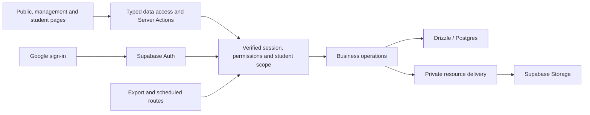
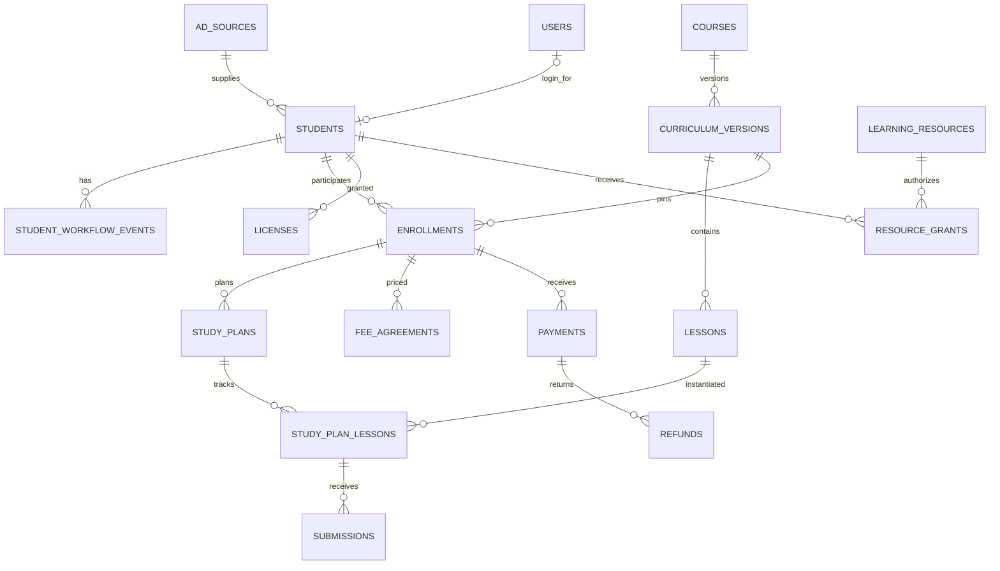

# Superseded expanded design

Retained as discovery analysis only. The lean v1 specification in [backend-database-design.md](../backend-database-design.md) replaces this proposal for implementation.

# Backend and database design proposal

Date: 2026-10-09. Basis: [Business workflow review](../business-workflow-review.md), the supplied course screenshot, and the current repository. This document designs the implementation; it does not apply migrations or change business data.

Confirmed requirements include one student identity across the workflow, the old code method, source-scoped sales access, human Zalo messaging, separate editable progress and view-only resources, two learning phases, and trial lessons 2/13/14. Unconfirmed commercial rules remain explicit decisions rather than automatic calculations.

## 1. Architecture

Keep one Next.js application. Supabase provides Postgres, Google authentication, and private file storage. Drizzle owns business-table queries and migrations; zod validates inputs. No additional API service is needed for v1.

Pages call `src/lib/api`; protected reads resolve the session at the boundary and pass the resulting user to server queries. Queries enforce permissions and scope themselves. Mutations validate input, resolve the user, load the scoped target, execute a short database transaction, append audit/history, and invalidate affected views.

Server Actions handle user operations. Route Handlers cover OAuth callback, authorized file delivery/downloads, exports, cron, and future machine integrations. Proxy refreshes sessions and performs optimistic routing only. Read sessions at request time behind Suspense; initially keep user-sensitive reads uncached except for request-local deduplication.

## 2. Identity and independent business states

`students.id` is the stable internal UUID for a person/prospect. Enrollment adds related records to this identity instead of copying the person into another register. `users.id` represents a login account, not a lead or a payment.

Keep these concerns separate:

| Concern | Authoritative data | Important distinction |
| --- | --- | --- |
| Sales conversation | Student stage, status history, notes and workflow events | Agreeable response is not payment |
| Course participation | Enrollment access level and lifecycle | Trial/formal access is not an add-in license |
| Learning | Personal plan, submissions, reviews and attendance | A viewed lesson is not an approved exercise |
| Money | Agreed fee, confirmed receipts and confirmed refunds | Quoted fee is not received cash |
| Add-in use | License grant, validity dates and revocation | Payment alone does not grant a license until a rule is confirmed |

A student can therefore have an active trial enrollment, no payment, and an explicitly granted license without corrupting a single combined status.

The current eight-value pipeline remains a draft implementation. A proposed future CRM summary is new -> consulting -> trial -> enrolled, with dropped as a side branch; exact stage names and legacy mappings require confirmation. Do not replace the existing enum or translate old flags during this design step. Formal enrollment is a domain operation, not an unrestricted status dropdown.

## 3. Logical schema

All business records use UUIDs, timezone-aware timestamps, explicit foreign keys, and RLS as required by BACKEND_RULES. Money uses whole-VND bigint values. Identity timestamps retain actual instants; reporting periods use Asia/Ho_Chi_Minh. Personal availability uses local weekday/time plus timezone. Email is normalized lowercase without rewriting historical non-Gmail addresses.

### A. Accounts, sources and student identity

| Table | Main fields / purpose | Constraints |
| --- | --- | --- |
| `users` (existing) | Email, auth user ID, staff/student name, disabled timestamp | Unique normalized login email and auth user ID |
| `user_roles` (existing) | User and admin/sale/student role | Unique user/role pair |
| `ad_sources` (existing) | Stable source code, current owner, active flag | Unique source code; source deactivation preserves students |
| `source_code_counters` (new) | Source, code period, next sequence | Unique source/period; atomic allocation |
| `students` (extend) | Source, code period/sequence, current code, name/contact, background, acquisition channel, signup answers, linked user, current CRM stage | Unique source/period/sequence after old-code rules are confirmed; nullable unique linked user for one person per login |
| `student_identifiers` (new) | Student, identifier kind, legacy value, provenance reference | Preserve ambiguous legacy short codes without global uniqueness |

Keep birth year, specialty, hometown, organization, and acquisition channel as typed fields when filtered/reported. Preserve the original questionnaire version and extra answers in bounded JSONB. Keep course fee and policy out of the student identity record.

The owner prefers the old code method. The data suggests period-based sequences, but the exact format/reset boundary is still pending. Replace the lifetime source/sequence constraint and allocator only in a new reviewed migration after confirmation. If legacy short labels collide, retain them as aliases; never use them as primary keys. Preserve imported labels separately from any name-dependent label generated for future Zalo copying.

Allocate a sequence inside the same transaction as signup using a source/period counter upsert/update with database locking. Never use `max + 1`. A server-accepted signup request key plus payload fingerprint makes exact retries idempotent; different submissions with similar contacts become review candidates, not silent merges. Source link attribution is validated against active sources; staff cannot reassign a source through a generic profile-edit action.

### B. Consultation and workflow history

| Table | Main fields / purpose |
| --- | --- |
| `student_status_events` (existing) | Previous/new CRM stage, actor, reason, timestamp |
| `call_notes` (existing) | Human consultation notes and author |
| `student_workflow_events` (new) | Student, typed milestone, occurred time, actor, bounded metadata, optional correction reference |
| `message_templates` (extend) | Title, body, workflow step, order, revision, active flag |
| `audit_log` (existing) | Operation, actor, entity, minimal change metadata, timestamp |

Suggested milestone types: contact established, group 1 joined, group 2 joined, fee quote sent, software ready, consultation completed, trial started, payment instructions sent, official Zalo contact confirmed. These are a proposed checklist, not mandatory conversion gates yet.

Store a template identifier/revision when staff explicitly records a sent message. Copying a template can be recorded as a copy event but never as proof it was sent. Milestone corrections append events; histories are not erased. Render templates only with fields allowed for the current caller. Sales templates must not expose admin-only payment/license details through placeholders.

### C. Curriculum, enrollment and personal plans

| Table | Main fields / purpose | Constraints |
| --- | --- | --- |
| `courses` (new) | Main course/suite identity and public description | Stable course ID |
| `curriculum_versions` (new) | Course, revision, draft/published state, publication time | Unique course/revision; published content is immutable |
| `lessons` (new) | Curriculum version, foundation/specialist phase, topic, order, legacy number, suggested duration, nullable trial order | Unique applicable lesson order and non-null trial order within a version |
| `enrollments` (new) | Student, course/version, trial/formal access level, active/paused/completed/cancelled lifecycle, trial start/end, formal activation time | At most one active enrollment per student/course in v1 |
| `study_plans` (new) | Enrollment, start date, duration coefficient, project brief, revision | One current plan per enrollment |
| `study_plan_lessons` (new) | Plan, lesson, selection, agreed due date, student-reported state, reviewer-approved state and dates | Unique plan/lesson; verify lesson belongs to enrollment curriculum |
| `study_availability` (new) | Student, weekday, local time window, timezone | Valid start/end window |
| `submissions` (new) | Plan lesson, private object reference or approved link, submitted time, review state/feedback/reviewer | Multiple attempts allowed; preserve each attempt |

The main course groups both learning phases. One formal enrollment can cover both phases without creating a second paid purchase. It does not imply perpetual access; access end dates remain explicit policy decisions.

Trial content is selected by lesson ID, with trial order 1/2/3 pointing to foundation lessons 2/13/14 in the verified curriculum. Do not implement `lessonNumber <= 3`. Pin enrollment to a version so a future curriculum edit cannot change existing trial selections or progress.

Create a personal plan from a published version. Changes to due dates/selections are audited. Adopting a newer curriculum is an explicit admin operation with a preview preserving completed work; publishing alone leaves current plans unchanged. Student updates are restricted to confirmed self-report/submission fields. Instructor approval fields and curriculum definitions are not student-editable. Initially use admin as reviewer; do not invent a teaching-assistant role.

If actual session booking/attendance is required in v1, add `teaching_sessions` and `session_attendees`: scheduled/held time, one-to-one/group type, topic and attendance. Submitted work and one-to-one session counts must remain separate. Specialist Saturday sessions can be entered explicitly; full recurring-scheduling automation is deferred.

### D. Resources and access

| Table | Main fields / purpose |
| --- | --- |
| `learning_resources` (new) | Lesson/course association, resource type, private object path, access audience, view/download mode, revision |
| `resource_grants` (new) | Student/resource, validity window, grant reason/actor, revocation time; unique student/resource grant identity |

Standard course access is derived from the active enrollment and curriculum membership. Explicit grants handle individual exceptions. A revoked/expired enrollment denies standard access; an independent explicit grant is evaluated under its documented reason and validity. Scope every student resource request and validate lesson/course membership; an arbitrary resource ID is not sufficient.

Educational documents use an authenticated viewer without download controls or original Drive links. Backend uses private storage and short-lived authorized delivery; material storage paths are not part of ordinary client DTOs. View-only is an access/presentation rule, not a guarantee that already delivered content cannot be saved. Downloadable installer assets have a distinct delivery mode and may use direct short-lived signed downloads to avoid routing large files through app functions.

### E. Fees, receipts and refunds

| Table | Main fields / purpose | Constraints |
| --- | --- | --- |
| `fee_agreements` (new) | Enrollment, revision, quoted/agreed fee, currency, package/policy snapshot, approval, superseded time | Nonnegative fee; one current approved agreement |
| `payments` (extend existing) | Student/enrollment, confirmed receipt amount, method, actual paid time, external reference, operator, correction/reversal state | Positive amount; unique payment operation key and external reference when present |
| `refunds` (new) | Related payment/enrollment, amount, reason, pending/confirmed/cancelled state, actual refunded time and actor | Positive amount; prevent confirmed total refund exceeding the receipt |

Do not create a receipt when staff sends the fee or payment instructions. Pending payment claims, if needed, stay distinguishable from confirmed receipts. A change to the agreed fee creates a revision; it does not rewrite a past payment. Corrections retain the original record and reason, and refund confirmation means money actually returned, not merely promised.

Calculate on the server:

- Net received = valid confirmed receipts - confirmed refunds.
- Outstanding = max(0, current agreed fee - net received).
- Overpaid credit = max(0, net received - current agreed fee).
- Cash movement for a month uses actual receipt/refund dates, not signup month or quoted fees.

Free/special enrollment requires an explicit approved fee agreement and activation reason; zero fee alone is not a receipt. Do not automatically cancel enrollment or revoke a license after a refund until the business rule is confirmed. Preserve unread legacy money flags as import metadata for reconciliation, not as fabricated financial transactions.

### F. Licenses and referrals

Extend `licenses` with grant reason, actor and revocation metadata. Keep email/product, start/end, student link and status. The entitlement check evaluates validity dates on every request rather than relying only on a nightly expired-state update. Avoid overlapping active grants for the same email/product unless product policy deliberately permits them; serialize grant changes for that key. Decide suite-versus-product precedence before exposing a checker.

Admin explicitly grants/renews/revokes until eligibility is confirmed. Account email changes do not silently transfer existing licenses. The later add-in check must authenticate the user's Google identity; a caller-supplied email plus an embedded application API key is not sufficient proof of ownership. This is a proposed correction to the future integration sketch, not a live API change.

Keep `students.referredById` for the referral relationship with no self-referral or referral cycles. Add `referral_awards` when referral management is implemented: referrer, policy revision, qualification evidence snapshot, proposed/approved/applied state, approver and any resulting fee-agreement/refund reference. An award can reference only the approved referrer's enrollment and financial records.

The three published offer tiers are known, but qualification timing is not. Initially qualification/awards require admin confirmation. Later compute candidates from verified trial-participation and formal-enrollment events, never just copied messages or a raw signup count. Financial effect is idempotent per award: approval cannot issue the same discount/refund twice. Tracking an earned refund and confirming its actual payment remain separate operations.

Agency ranks/commissions remain deferred. Preserve historical policy text privately. Add agreements/settlements only after eligibility, recipients, rate basis and visibility are confirmed; agency rank is not a login role.

### G. Import provenance

`import_batches` stores input digest, source category, mapping revision, operator, dry-run/approved/completed/failed state and result counts. `import_records` stores batch/row provenance, a stable source-record key, candidate student, applied entity IDs, validation state and exception reason. Keep raw values restricted to authorized import operators and out of application logs.

Unique provenance/application keys prevent a rerun from inserting the same receipt or student again. File digests alone do not deduplicate revised exports. Short codes and matching emails generate candidates, not automatic merges. Record explicit approved matches; reject ambiguous financial merges. The source workbook's timezone/locale must be identified before converting timestamps; do not blindly reinterpret the admin sheet's US timezone as the actual Vietnamese signup timezone.

## 4. Relationships

Index foreign keys used by scoped lookups/joins, especially student, source, enrollment, plan, lesson and resource links. Add composite indexes for `(source_id, signed_up_at, id)`, student timelines `(student_id, occurred_at, id)`, payment/refund dates, and email/product license lookups. Let unique constraints cover their own lookup indexes rather than duplicating them. Start with bounded/paginated queries; add specialized name-search indexes only after the actual query is measured.

The diagram is a domain overview. Legacy standalone receipts/licenses may retain nullable enrollment/student links while they are reconciled; the existing student relationship on receipts is preserved.

## 5. Authorization

| Operation/data | Admin | Sale | Student |
| --- | --- | --- | --- |
| CRM identity, notes, milestones, templates | All | Own sources; restricted edits | Own permitted profile only |
| Role/account activation, source reassignment | Yes | No | No |
| Fee agreements, receipts, refunds, commercial exceptions | Yes | No pending an explicit scope change | Approved personal referral/fee summary only |
| License management | Yes | No | Own status projection only |
| Learning plan/resource grants/reviews | Yes | No by default | Own authorized content; approved edit fields only |
| CRM exports/acquisition report | All | Own sources and permitted columns | No management exports |
| Financial reports/import/backup/settings | Yes / authenticated system job | No | No |

Every students-related query joins back to `students` and applies `studentScope(user)`. Student-area operations add an explicit own-student condition, even for a user who also has a sales role: the current helper prioritizes the sales scope and alone cannot enforce student-area ownership for a multi-role account. Admin preview is a separate explicit permissioned flow.

Generic `students.edit` must not allow mutation of source, account linkage, money, entitlement or role fields. Add granular permissions such as activation, plan management, self-progress reporting, submission review and own-license viewing. Scope checks protect both row visibility and related-resource membership; return narrow DTOs with no hidden financial data.

Follow the repository's server-only data-access architecture: enable RLS on business tables without public read/write policies. Drizzle's database-owner connection bypasses RLS, so action/query permission and scope checks are mandatory. Storage rules are designed separately from business-table policies. Secrets stay server-side. Public signup exposes only a generic result/code and has bounded input plus abuse controls.

## 6. Important operations and transactions

| Operation | Atomic database work | Separate side effects |
| --- | --- | --- |
| Submit signup | Allocate old-format code, insert student, initial history and audit, record request key | Staff notification only if separately authorized |
| Prepare trial | Lock scoped student, create/reuse enrollment and versioned plan, trial window when confirmed, milestone and audit | Activate login only according to the approved trial policy |
| Record consultation milestone | Append milestone, any confirmed stage transition and audit | Staff copies/sends Zalo text manually |
| Record payment | Lock enrollment/financial scope, insert idempotent confirmed receipt and audit | Payment confirmation alone does not enable license |
| Activate formal course | Check approved fee agreement and activation policy, update same enrollment, account linkage/role if needed, stage event and audit | Add-in grant only when expressly included/confirmed |
| Approve submitted work | Update permitted review fields with expected revision, append review/audit | Refresh derived progress |
| Apply referral award | Validate award state, create fee revision/refund request once, record linkage and audit | Actual money return requires its own confirmation |
| Grant/revoke license | Serialize email/product grants, validate dates, persist reason and audit | Add-in identity integration is later |

Use expected row revisions for concurrent staff edits so one browser does not overwrite another. Duplicate operation keys replay the original authorized result only when the payload matches. Lock the enrollment/payment scope when checking over-refunds or applying financial awards. Do not hold database transactions open during external calls, storage transfers, workbook generation, or manual communication.

## 7. Reports, exports and recovery

Compute operational reports from normalized data; no generic `reports` table is needed for ordinary filters. Define acquired leads by signup/source, conversion by confirmed enrollment event, and financial movement by payment/refund dates. Sales reports exclude all financial columns until explicitly authorized. Never reproduce a guessed legacy conversion/commission formula.

Exports rerun the same scoped query and filters as the screen. Monthly exports identify report timezone, period, generated time and metric definitions. If an issued monthly report must later be reproducible, persist an immutable snapshot with its criteria/version; do not silently overwrite it when records are corrected.

Keep the specified nightly Excel backup for operational readability, plus database recovery backups and private-file recovery. Excel exports alone do not restore auth identities, schema or file contents. Verify an isolated restore before cutover. System backup access uses explicit authenticated job authority rather than an ordinary user's unscoped request.

Keep v1 transition as one-off imports plus website exports per BACKEND_RULES, unless the owner explicitly changes scope to live synchronization. Add the documented ignored raw-data directory before saving any real export locally. No automatic Zalo messages or payment movement is introduced.

## 8. Implementation sequence

1. Confirm the exact old code/reset specification; add identity/provenance and counter migration. Preserve the applied initial migration.
2. Build Google activation, scoped CRM list/profile, consultation checklist, message copy, and Excel export. Import preview can run as the one-off script rather than a full new UI.
3. Add versioned curriculum, enrollment, personal plans and resource access. Trial access uses 2/13/14; activation timing remains gated on the client decision.
4. Add fee agreements, receipts/refunds and formal activation with explicit policy. Extend license management; keep automatic add-in verification deferred.
5. Add approved referral qualification, reports, backup/restore and optional attendance. Defer agency settlements, payment gateways and self-install automation.

Required implementation verification includes sales A/B cross-access, multi-role student ownership, unauthorized direct action/resource requests, concurrent code allocation, repeated signup/payment/award retries, over-refund races, curriculum version stability, trial-only resources, scoped exports, and repeat import/restore reconciliation. Run `pnpm typecheck` and `pnpm lint` before committing code changes.

## 9. Decisions still pending

Client questions remain in [the workflow review](../business-workflow-review.md#questions-for-the-next-client-conversation). In particular: old code reset, legacy payment flags, trial login/edit permissions, fee packages, formal activation/payment condition, license validity, referral qualification/window, curriculum upgrades and agency commissions. The design supports these choices without assuming their answers.

## Technical references checked

- Bundled Next.js 16 authentication-with-cache-components and data-security guides in `node_modules/next/dist/docs/01-app/02-guides/`.
- [Supabase row-level security](https://supabase.com/docs/guides/database/postgres/row-level-security).
- [Supabase storage delivery](https://supabase.com/docs/guides/storage/serving/downloads).
- [PostgreSQL foreign-key constraints](https://www.postgresql.org/docs/current/ddl-constraints.html#DDL-CONSTRAINTS-FK).
- Supabase changelog index checked on the review date; the listed extension/operator upgrade notices do not affect any extension/operator used by this logical proposal.
