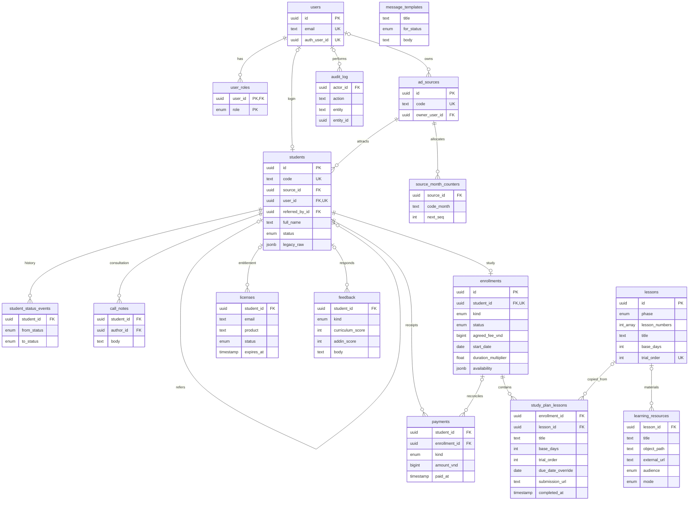

# Database relationships — lean v1

This diagram reflects the current 16-table Drizzle schema. It shows selected business columns and the main foreign keys; not every staff attribution or timestamp is displayed. PK = primary key, FK = foreign key, UK = unique key. Nullable foreign keys are optional links.

- Acquisition: a sales owner manages sources; each source/month has a counter. Students retain the source attribution, CRM stage, six checklist timestamps and original import metadata.
- Identity: a lead may exist without a login account. A linked account may have multiple roles. Each account links to at most one student.
- Learning: a student has at most one enrollment in v1. Its plan copies lesson titles, numbers and durations. Changing a template does not change an existing plan. Trial selection uses trial_order 1/2/3 for lessons 2/13/14.
- Finance and tools: the agreed fee belongs to the enrollment; actual payments/refunds belong to payments. Licenses remain independently administered. The optional payment enrollment link is enforced together with student_id by a composite foreign key.
- Operations: message_templates.for_status is an enum value, not a foreign key to a student. audit_log.entity_id is a generic record reference, not a database foreign key. Call notes, status history and payments also have optional staff attribution foreign keys to users, omitted from the diagram for readability.
- Resource origin: exactly one private Storage object or allowed external video URL. Resources may be general or linked to a lesson; audience and mode control intended availability and presentation.
- Dates: commitment dates are calculated from start_date, cumulative copied base_days and duration_multiplier. Only manual per-lesson overrides are persisted.

`||` = exactly one; `o|` = zero or one; `o{` = zero or many. For example, students ||--o| enrollments means each enrollment belongs to one student, while a student may have no enrollment yet.
